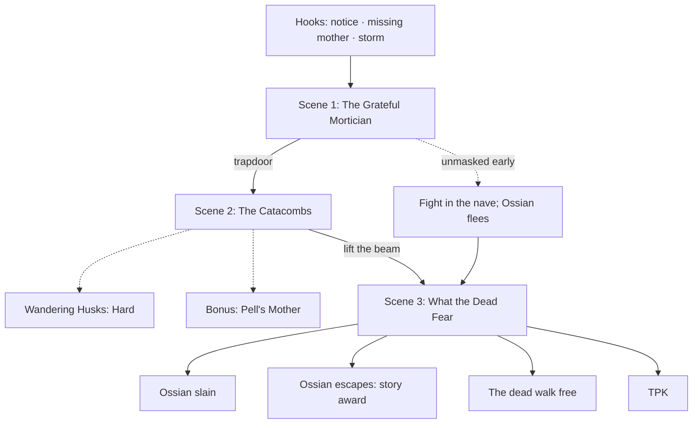

# Appendix: Adventure Flowchart

![[SP-OP01 flowchart.png]]

## How the Session Moves
- **Hooks → Scene 1.** Every hook ends at the lychgate of [[Merrow's Rest]].
- **Scene 1 → Scene 2** through the trapdoor behind the altar, with Ossian's sketch ([[SP-OP01 — Handout — Ossian's Sketch|Handout 4]]) in hand.
- **Unmasked early.** If the party exposes Ossian in the chapel, he fights in the nave without his larder and flees up the bone chute once bloodied. Go straight to Scene 3's statblock and endings; the dead below can still be saved.
- **Wandering Husks** hang off Scene 2: the avoidable problem. Every rest, delay or racket below risks a Hard fight.
- **The bonus objective** ([[SP-OP01 — Bonus Objective — Pell's Mother]]) threads through all three scenes and closes back at the lychgate.
- **Scene 3** ends in one of four ways: Ossian slain, Ossian escapes (story award [[SP-OP01 — Story Award — He Remembers Your Face|He Remembers Your Face]]), the dead walk free, or a total party kill.

